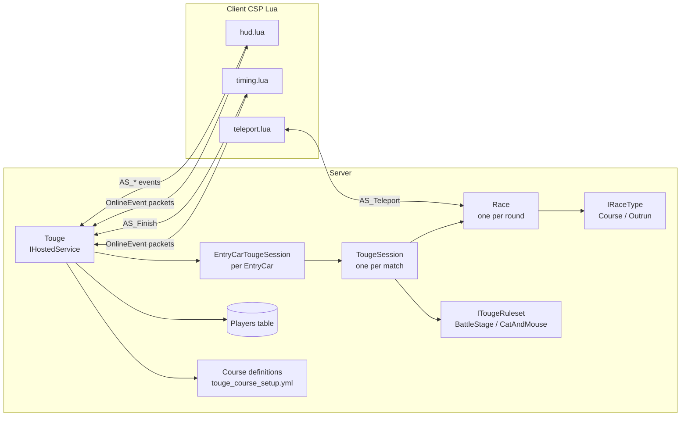
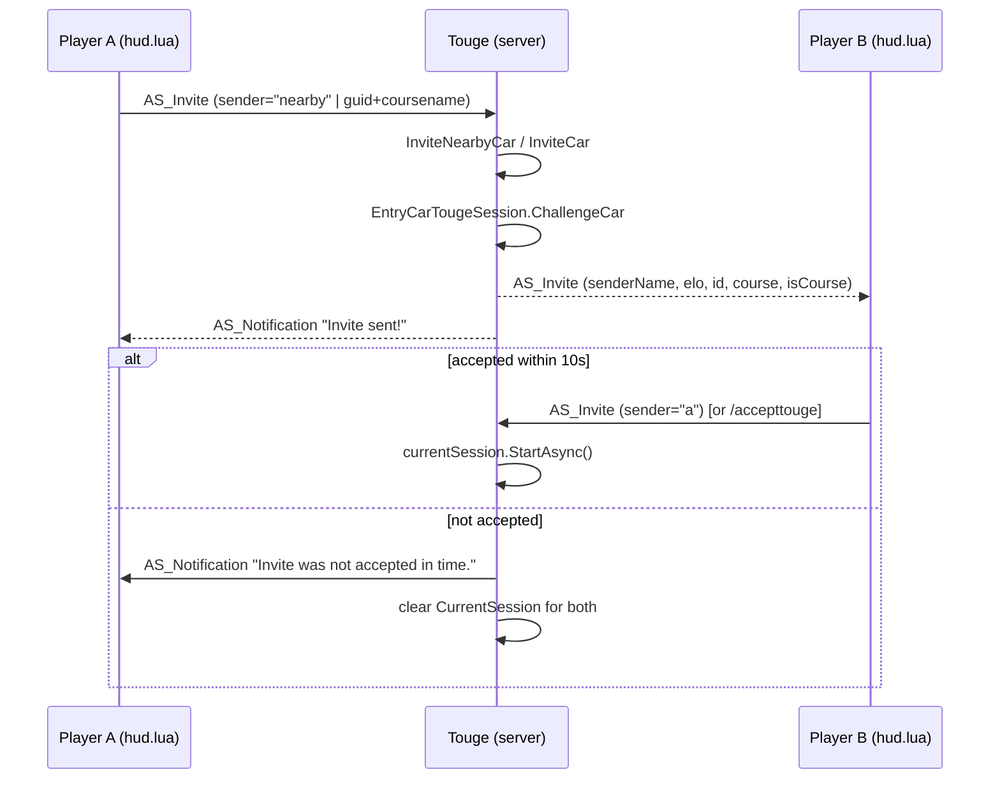
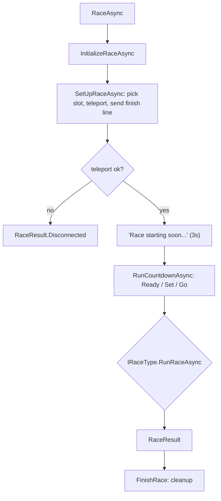

# TougePlugin — Architecture & End-to-End Flow

This document describes how the Touge Plugin works internally: its components, their
responsibilities, and the full lifecycle from server startup through a completed
head-to-head touge race (and Elo update).

The plugin is written in C# for [AssettoServer](https://github.com/compujuckel/AssettoServer)
(`v0.0.55-pre45`, .NET 11) and pairs a server-side driver with three Lua client scripts that
are delivered to every connected player via CSP (Custom Shaders Patch) online events.

---

## 1. Component Map

| Component | File | Responsibility |
|-----------|------|----------------|
| `TougeModule` | `TougeModule.cs` | Autofac DI wiring: registers services, keyed rulesets/race types, and factory delegates. |
| `Touge` | `Touge.cs` | Root service (`BackgroundService`/`IHostedService`). Owns courses, database, CSP packet routing, and per-car session map. |
| `TougeConfiguration` + `TougeConfigurationValidator` | `TougeConfiguration.cs`, `TougeConfigurationValidator.cs` | Config model + FluentValidation rules (`plugin_touge_cfg.yml`). |
| `EntryCarTougeSession` | `EntryCarTougeSession.cs` | Per-car session owner. Sends/accepts invites, starts sessions, finds nearby cars. |
| `TougeSession` | `TougeSession.cs` | One match between two cars. Holds standings, runs the ruleset, applies results, computes Elo. |
| `Race` | `Race.cs` | One single run (leader vs follower). Handles setup, teleport, countdown, forfeit, and delegates race logic to an `IRaceType`. |
| `ITougeRuleset` (2 impls) | `TougeRulesets/` | Defines how many races make up a session and how a winner is decided. |
| `IRaceType` (2 impls) | `RaceTypes/` | Defines the win condition of a single race (course vs outrun). |
| `IDatabase` / `IDbConnectionFactory` | `Database/` | Player Elo persistence (SQLite local mode or PostgreSQL). |
| Packets | `Packets/` | Serializable CSP online-event structs sent between server and client. |
| Lua scripts | `lua/` | Client-side teleport, finish detection, and HUD. |
| Course models + YAML converters | `Models/`, `Serialization/` | Parse/validate `cfg/touge_course_setup.yml`. |

---

## 2. Runtime Architecture



The server communicates with clients exclusively through **CSP online events**
(`AssettoServer.Network.ClientMessages`). The packets listed in `Packets/` are the contract;
the Lua scripts under `lua/` are the reference client implementation of that contract.

---

## 3. Startup & Initialization

### 3.1 DI registration (`TougeModule.Load`)

- `Touge` → registered as `IHostedService` **singleton** (so the server instantiates and
  runs it automatically).
- `EntryCarTougeSession`, `TougeSession`, `Race` → transient, resolved via factories so
  runtime arguments (cars, ruleset, course, race type) can be passed in.
- Keyed registrations:
  - `ITougeRuleset` keyed by `RulesetType.BattleStage` → `BattleStageRuleset`
  - `ITougeRuleset` keyed by `RulesetType.CatAndMouse` → `CatAndMouseRuleset`
  - `IRaceType` keyed by `RaceType.Course` → `CourseRace`
  - `IRaceType` keyed by `RaceType.Outrun` → `OutrunRace`
- Factory delegates for `Func<RulesetType, ITougeRuleset>`,
  `Func<RaceType, IRaceType>`, `TougeSession.Factory`, and `Race.Factory`.

### 3.2 Constructor (`Touge`)

1. **Config sanity check** — `CheckConfiguration()` throws unless:
   - `extra_cfg.yml` has `EnableClientMessages = true`
   - `extra_cfg.yml` has `MinimumCSPVersion >= 1937`
2. **Provide Lua scripts** — reads and registers `teleport.lua`, `hud.lua`, `timing.lua`
   with the server's `CSPServerScriptProvider`, so they are pushed to every
   client automatically.
3. **Database setup** —
   - `IsDbLocalMode == true` → `SqliteConnectionFactory("plugins/TougePlugin/database.db")`
   - otherwise → `PostgresConnectionFactory(PostgresqlConnectionString)`
   - calls `InitializeDatabase()` (creates the `Players` table if absent).
   - wraps it in `GenericDatabase` (exposed publicly as `database`).
4. **Register CSP inbound events** —
   - `InitializationPacket → OnInitializationPacket`
   - `InvitePacket → OnInvitePacket`
   - `LobbyStatusPacket → OnLobbyStatusPacketAsync`
   - `ForfeitPacket → OnForfeitPacket`
   - `FinishPacket → OnFinishPacket`
5. **Load courses** — `GetCourses()` (see §3.3).
6. **Check avatars folder** — `CheckAvatarsFolder()` creates `wwwroot/avatars`, verifies disk
   space, and disables avatars gracefully if it cannot.

### 3.3 `GetCourses()` — course loading & validation

1. Derives the track key from `_serverConfig.FullTrackName` (everything after the last `/`).
2. Reads `cfg/touge_course_setup.yml`. If missing, writes a sample file and throws.
3. Deserializes with custom `Vector3YamlConverter`, `Vector2YamlConverter`,
   `CarSpawnYamlConverter`.
4. Requires the track to exist, otherwise throws `KeyNotFoundException`.
5. `ValidateCourses()` enforces, per course:
   - name ≤ 32 chars
   - a valid `FinishLine` (exactly 2 points) when `UseTrackFinish == false`
   - at least one `StartingSlot`
   - every starting slot has `Leader` and `Follower` with both `Position` and `Heading` set.

> Note: the README documents an `.ini`-style format, but the actual parser reads a YAML
> structure (`Tracks: <track>: Courses: <course>: FinishLine / StartingSlots`).

### 3.4 `ExecuteAsync()` (service start)

- Creates one `EntryCarTougeSession` per `EntryCar` and stores it in `_instances` (keyed by
  `SessionId`).
- Subscribes to `EntryCarManager.ClientConnected` and `ClientDisconnected`.

---

## 4. Player Connection / Lobby Flow

### 4.1 On connect

`OnClientConnected`:
1. `database.CheckPlayerAsync(guid)` — creates a row (`Rating = 1000`,
   `RacesCompleted = 0`) if the player is new.
2. If `SteamAPIKey` is set, `LoadAvatar()` downloads/caches the Steam avatar
   (`SteamAPIClient.GetSteamAvatarAsync`), with a 4 MB disk cache and oldest-first eviction.

### 4.2 Client asks for initialization

The client's `hud.lua` sends an empty `AS_Initialization` event. The server responds in
`OnInitializationPacket` with the player's current `Elo`/`RacesCompleted` and session
configuration: `UseTrackFinish`, `DiscreteMode`, `LoadSteamAvatars`, all course names
(delimited by `` ` ``), and `ShowRaceTypeToggle` (true only when both course and outrun races
are enabled).

### 4.3 Invite menu (nearby-player list)

`hud.lua` requests the lobby list by sending `AS_LobbyStatus`. `OnLobbyStatusPacketAsync`:
1. Finds the 5 nearest cars via `FindClosestCars(5)`.
2. Fetches each player's Elo, and flags `inRace` (has a `CurrentSession`).
3. Pads to exactly 5 entries with dummies (`name=""`, `id=0`, `elo=-1`).
4. Sends a populated `AS_LobbyStatus` back to the requesting client.

---

## 5. The Invite Flow



### 5.1 `OnInvitePacket` (server-side dispatch)

Three modes, selected by the `InviteSenderName` field:
- `"nearby"` → `InviteNearbyCar(client)` — invites the single closest car (within 30 m).
- `"a"` → **accept** path. Accepts only if `CurrentSession != null`, the receiver is not the
  challenger, and the session is not already active; then `startSession.StartAsync()`.
- anything else → **invite by GUID**. If `CourseName` is empty, falls back to the first
  course.

### 5.2 `InviteCar` / `ChallengeCar`

`InviteCar` resolves the recipient `EntryCar` by GUID, then decides the definitive race type:
only if **exactly one** of course/outrun is enabled is the type forced; otherwise the client's
`IsCourse` flag is used.

`EntryCarTougeSession.ChallengeCar` then:
1. Validates state — rejects if sender or recipient already has a session (active or pending),
   or if the sender is inviting themselves.
2. Resolves the configured ruleset, the selected course, and the race type.
3. Creates a new `TougeSession` through the factory and assigns its reference to **both**
   cars' `CurrentSession` (the session object is shared).
4. Sends `AS_Invite` to the recipient (their `hud.lua` shows the incoming-invite card).
5. Starts a 10-second timeout: if the session is still inactive afterwards, it clears
   `CurrentSession` on both cars and notifies the sender that the invite expired.

### 5.3 Acceptance

Accepted through either:
- The in-game key (`M`) or UI button → sends `AS_Invite { InviteSenderName = "a" }`, or
- The chat command `/accepttouge` (`TougeCommandModule.AcceptInvite`).

Both call `TougeSession.StartAsync()`.

---

## 6. Session Lifecycle (`TougeSession`)

```mermaid
sequenceDiagram
    participant TS as TougeSession
    participant RS as ITougeRuleset
    participant R as Race
    participant DB as Database

    TS->>RS: RunSessionAsync(this)
    loop races per ruleset
        RS->>TS: RunRaceAsync(leader, follower)
        TS->>R: _raceFactory(...); race.RaceAsync()
        R-->>TS: RaceResult
        TS->>RS: result
    end
    RS-->>TS: final RaceResult
    TS->>TS: UpdateStandings(winner, 2, Finished)
    TS->>DB: UpdateEloAsync(winner)
    TS->>TS: BroadcastChat "X beat Y"
    TS->>TS: FinishTougeSessionAsync (clear sessions, cooldown, HUD off)
```

### 6.1 `StartAsync` / `TougeSessionAsync`

- `StartAsync` is idempotent (`IsActive` guard) and launches `TougeSessionAsync` on a
  background task.
- `TougeSessionAsync`:
  1. `result = await _ruleset.RunSessionAsync(this)`.
  2. If not disconnected: records the final result at scoreboard slot #2 with
     `SessionState.Finished`, calls `UpdateEloAsync`, and broadcasts
     `"{winner} beat {loser}"` to the whole server.
  3. `finally` → `FinishTougeSessionAsync()`.

### 6.2 `FinishTougeSessionAsync`

- Clears `CurrentSession` on both cars.
- Waits `coolDownTime` (6 s) so the scoreboard remains visible briefly.
- Resets both standings arrays to `Tbd` and sends `SessionState.Off` (hides HUD).

### 6.3 Standings & HUD state

- Standings are three-element arrays per player (`challengerStandings`,
  `challengedStandings`), each slot `Tbd/Win/Loss/Tie`.
- `UpdateStandings(winner, index, hudState)` writes mirrored values for both players and calls
  `SendSessionState`, which sends `AS_SessionState { result1..3, sessionState }` to both cars.

`SessionState` values: `Off(0)`, `FirstTwo(1)`, `SuddenDeath(2)`, `Finished(3)`,
`CatAndMouse(4)`, `NoUpdate(5)`.

---

## 7. Race Lifecycle (`Race.cs`)

A `Race` is **one** head-to-head run (one leader vs one follower). A session runs multiple
races.



### 7.1 Setup (`SetUpRaceAsync`)

1. `GetStartSlotsAsync()` picks the first starting slot whose points are clear of other cars
   (watches up to ~10 s, falls back to slot #0).
2. If `UseTrackFinish == false`, `SendFinishLine()` pushes the 2D finish line points to both
   clients (`AS_FinishLine`).
3. `TeleportToStartAsync()` sends `AS_Teleport` to both cars, then polls positions until both
   are within a threshold of their targets (250 ms interval, 10 s timeout). Locks controls
   during the move.
4. Returns the spawn pair, or `null` on failure/cancel.

Forfeit during setup is handled by racing the setup task against the `Forfeit` TCS.

### 7.2 Countdown (`RunCountdownAsync`)

Loop through three signal stages ("Ready…", "Set…", "Go!"), 1 s apart. Each tick:
- **Standing start** (`IsRollingStart == false`): `AreInStartingPos` checks for jumpstarts.
  - both moved → restart the race (`RestartRaceAsync` re-teleports).
  - follower moved → leader wins immediately.
  - leader moved → follower wins immediately.
- **Rolling start**: at the "Go!" stage, `IsValidRollingStartPos` requires the cars to be
  within 30 m of each other; otherwise restart.
- At "Go!": set `IsGo = true`.
- Messages use `SendTimedMessageAsync` (sends to the higher-ping player first, delays by the
  ping difference) to keep the countdown fair across both screens.

### 7.3 Lap / finish events

`OnClientLapCompleted` updates the leader/follower lap flags and signals:
- both finished → `SecondLapCompleted`
- only leader finished → starts the outrun timer, then `SecondLapCompleted(false)`
- follower finished first → `FollowerFirst`

### 7.4 Forfeit / disconnect

The `Disconnecting` event routes into `ForfeitPlayer`:
- Sets `_cancelled`.
- If the race already started **and** is a course race → signals `Disconnected`.
- Otherwise → signals `Forfeit`.
- Disables custom finish-line detection and unlocks controls.

---

## 8. Rulesets

### 8.1 BattleStage (default)

1. HUD → `FirstTwo`.
2. **Race 1**: challenger leads, challenged follows. Apply result at slot 0, cooldown.
3. **Race 2**: roles swapped. Apply result at slot 1, cooldown.
4. Decide:
   - Not a tie → `Win(winner)`.
   - Tie → HUD → `SuddenDeath`, alternate leader each race until someone wins
     (first win ends it; opponent must win to break a tie).

Tie detection (`IsTie`): either nobody won a race (`winCounter == 0`), or the two races were
split one-win-each.

Disconnect handling: if a player forfeits before/at race 2, the other player wins **only if**
they'd already won race 1; otherwise the result is `Disconnected`.

### 8.2 CatAndMouse

1. HUD → `CatAndMouse`.
2. Alternate leader/follower each round. First player to **2 points** (wins) wins the session.
3. Results are applied to standings per round (up to 3 slots). Ties award no points.
4. A disconnect immediately returns `Disconnected`.

---

## 9. Race Types

### 9.1 CourseRace (finish-line based)

- If `UseTrackFinish`: subscribes to the server's `LapCompleted` event on both clients (the
  game's built-in lap detection).
- Otherwise: sends `AS_Finish { LookForFinish = true }`; the client's `timing.lua` watches the
  custom 2D finish line and sends `AS_Finish` back when crossed.
- Waits on the first of `SecondLapCompleted` / `Disconnected` / `FollowerFirst`:
  - disconnected → `Disconnected`
  - follower never finished → leader wins (didn't pull away in `CourseOutrunTime`)
  - follower finished first → follower wins (overtake)
  - leader finished and follower finished within outrun time → **tie**
- Cleans up: sends `LookForFinish = false`, unsubscribes lap events.

### 9.2 OutrunRace (distance/lead based)

Loop every 250 ms:
1. Detect `Client == null` disconnects.
2. `UpdateLeader` — angle/speed-based overtake detection; announces overtakes and resets the
   lead timer.
3. **Teleport check** — if the leader's position jumps > 200 m in one tick, the chaser wins.
4. **Distance win** — leader ahead by `OutrunLeadDistance` → leader wins.
5. **Timeout win** — leader held the lead for `OutrunLeadTimeout` seconds → leader wins.
6. Forfeit check → `Disconnected`.

---

## 10. Elo Calculation

Default rating is **1000**; the `Players` table stores `Rating` and `RacesCompleted`.

```
carAdvantage     = (playerCarRating - opponentCarRating) / 100
effectiveElo     = playerElo - carAdvantage * 100
expectedResult   = 1 / (1 + 10 ^ ((opponentElo - effectiveElo) / 400))
maxGain          = MaxEloGain  (or MaxEloGainProvisional if RacesCompleted < ProvisionalRaces)
eloChange        = maxGain * (result - expectedResult)        # result = 1 win, 0 loss
carFactor        = clamp(1 - carAdvantage * 0.5, 0.5, 1.5)
adjustedChange   = round(eloChange * carFactor)
newElo           = max(0, playerElo + adjustedChange)
```

`UpdateEloAsync` computes both players' new ratings, persists them via
`UpdatePlayerEloAsync` (which also increments `RacesCompleted`), and sends each player an
`AS_Elo` packet so the HUD animates the change.

Car ratings come from `CarPerformanceRatings` (default **500** for unlisted cars).

---

## 11. CSP Packet Contract

All packets are `OnlineEvent` messages. Direction legend:
`S→C` server-to-client, `C→S` client-to-server, `⇄` bidirectional.

| Packet (Key) | File | Dir | Purpose |
|---|---|---|---|
| `AS_Initialization` | `InitializationPacket.cs` | ⇄ | Client requests init (empty); server replies with Elo/races/config/course list. |
| `AS_Invite` | `InvitePacket.cs` | ⇄ | Client sends invite/accept/nearby; server sends incoming-invite card to recipient. |
| `AS_LobbyStatus` | `LobbyStatusPacket.cs` | ⇄ | Client requests; server replies with 5 nearby-player entries. |
| `AS_Forfeit` | `ForfeitPacket.cs` | C→S | Client forfeits the session/race. |
| `AS_Finish` | `FinishPacket.cs` | ⇄ | Server toggles custom finish detection; client reports a finish-line crossing. |
| `AS_Elo` | `EloPacket.cs` | S→C | Server pushes the new Elo. |
| `AS_Notification` | `NotificationPacket.cs` | S→C | Toast text + optional countdown styling. |
| `AS_SessionState` | `SessionStatePacket.cs` | S→C | Standings (3 slots) + HUD state. |
| `AS_FinishLine` | `FinishLinePacket.cs` | S→C | Two 2D points defining the custom finish line. |
| `AS_Teleport` | `TeleportPacket.cs` | S→C | Move a car (position + heading). |
| `AS_LockControls` | `LockControlsPacket.cs` | S→C | Lock/unlock user input during teleport. |

---

## 12. Lua Client Scripts

| Script | Key responsibilities |
|--------|----------------------|
| `hud.lua` | Full HUD: Elo display/animation, invite menu (nearby list, course select, race-type toggle), incoming invites, standings, countdown/notifications, forfeit. Keybindings: `N` invite nearby, `I` invite menu, `M` accept, `H` hide tutorial, `F` hold-to-forfeit. Loads fonts/assets from `/static/TougePlugin/`. |
| `teleport.lua` | Handles `AS_Teleport`: raycasts down to ground level, briefly disables collisions, locks controls 10 s, then `physics.setCarPosition`. Also implements `AS_LockControls`. |
| `timing.lua` | Tracks `AS_FinishLine` points; on `AS_Finish { lookForFinish }` enables finish watching; per-frame segment-intersection test against the 2D line, sends `AS_Finish` up once crossed; reads `UseTrackFinish` from `AS_Initialization`. |

---

## 13. End-to-End Summary

1. **Boot** — `Touge` validates config, registers Lua scripts + CSP events, opens the DB,
   loads/validates courses.
2. **Connect** — server registers the player in the DB and (optionally) caches their avatar.
3. **Lobby** — client requests init and the nearby list; server returns config + top-5 cars.
4. **Invite** — challenger picks a nearby player (or GUID) and course; a shared `TougeSession`
   is created; recipient gets an invite card with a 10 s expiry.
5. **Accept** — `StartAsync` → ruleset runs one or more races.
6. **Race** — setup teleports both cars, countdown; the race type decides
   the winner of each run.
7. **Resolve** — ruleset decides the session winner, standings update, Elo recomputes and is
   broadcast, then the HUD resets after a short cooldown.